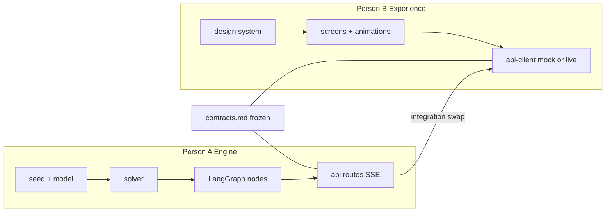

# Build Plan — CompanyTwin AI (v2: parallel two-person build)

**Version:** v2 (supersedes v1 sequencing only; the agent set, ADRs and "what makes it win" are unchanged).
**Audience:** both teammates and both Cursor agents. This file is the single source for *how we build*; it is committed in the repo so both people see the same plan.
**Status:** the parallel split (sections 4 to 10) is ready to use. The simulated-integrations scope (section 6) was **approved by the owner on 2026-11-28** and is now in the docs: PRD v0.2, architecture v0.3, rules v0.3, phases v0.3, and the frozen `docs/contracts.md` v1. Tickets TASK-024 to TASK-028 live in `docs/phases.md` (section 4 and 4a).

## 1. Context
SSI Agent-A-Thon entry; a strong placement matters to the owner. The five planning docs (PRD, architecture, design, rules, phases) are approved, `AGENTS.md` and `docs/memory.md` exist, TASK-001 (scaffold) is complete and Vercel is deployed. Every module under `twin/`, `agents/`, `orchestration/`, `api/` is still a stub; the UI is still the chat starter. The LiteLLM key is available. Deadline per `HACKATHON.md`: Mon Nov 30, 2:00 PM PKT (risk R7: confirm Nov 29 vs 30). We target the Day-2 release on Sunday night and keep Monday morning as buffer only.

Decision taken: **a tight 6-agent set with a fully closed loop, polished and deployed**, over a broader-but-thinner roster.

The rubric rewards end-to-end completeness with **visible multi-agent orchestration**, creativity, clean technical execution (key safe), a live easy-to-demo Vercel app, and business value. The winning shape is a **complete, visibly orchestrated, repeatable** demo, not a half-built ambitious one.

**Key insight that drives sequencing:** the agents are not the expensive part. Once the deterministic **solver**, the **step-loop plumbing**, the **base-agent scaffold** and the **UI trail** exist, each additional agent is a prompt plus a slice of facts. So we front-load plumbing and solver, prove one real agent end to end on Vercel early, then multiply agents, then close the loop, then polish.

## 2. Which agents, in what order (unchanged from v1)
Build the **hero trio first** (they carry the demo), then specialists, then close the loop:

1. **Impact Investigator** — traces a disruption across departments (task, QA, milestone, customer, invoice). What makes it a *company twin*, not a chatbot.
2. **Planner** — at least 2 recovery options with real, compared trade-offs (dates, deadlines, cost).
3. **Verifier (skeptic)** — **rejects an infeasible plan and forces a revision.** The differentiator that proves agents check each other. Non-negotiable.
4. **Finance specialist** — the $8,000 invoice exposure vs the $2,000 recovery budget.
5. **HR / Resource specialist** — "the backup is double-booked on Project B" constraint reasoning.
6. **Execution agent** — applies the approved plan and verifies the outcome (solver-backed; closes the loop). *Owner to confirm solver-only vs model-backed; recommendation is solver-only.*

The **Orchestrator** is the **LangGraph `StateGraph`** itself (nodes, edges and the conditional verifier-to-planner edge), not a separate model call. Observer and Sales are stretch nodes only. All agents are LangGraph nodes reaching the model only via `agents/llm.py` (`ChatOpenAI` to LiteLLM). HR and Finance run as **parallel nodes** (fan-out).

**If time runs short, finish in this order:** Impact, Planner, Verifier, then Finance, HR, Execution. Planner plus Verifier already make the graph demo-complete.

## 3. Original two-day blocks (still the milestone map)
v1 ran these blocks one after another. v2 runs them **in parallel across two people**; the milestones are unchanged.

### Day 1 (Sat) — working core, deployed, real calls
- **Block 1 Foundation (TASK-001, 003):** done (scaffold, Vercel deployed).
- **Block 2 Twin and solver (TASK-004, 005, 006):** `data/seed/northstar.json`, loader, twin model, **deterministic solver** with unit tests. The backbone that makes every number correct and repeatable.
- **Block 3 First real node end to end (TASK-008, 009, 010):** `ChatOpenAI` to LiteLLM factory (one retry, honest failure) plus fake chat model; LangGraph State, `StateGraph` skeleton and node budget; `POST /api/run/stream` running the **Impact** node with a real model call, streamed into a minimal trail, **on the live Vercel URL** (proves SSE and bundle size).
- **Day-1 milestone:** a deployed app that already looks like a multi-agent org twin doing real work.

### Day 2 (Sun) — full orchestration, closed loop, polish
- **Block 4 (TASK-011, 012):** HR and Finance steps; Planner produces at least 2 compared plans.
- **Block 5 (TASK-013, 007, 014):** Verifier reject-to-revise (capped at one revision); approval gate, apply, outcome verification, reset. The loop is closed.
- **Block 6 (TASK-015 to 018):** company-state screen and dependency chain; agent trail with per-step states incl. failed; plan comparison with fact tags (Fact / Calculated / Estimate); approval bar, outcome panel, progress rail.
- **Block 7 (TASK-019, 020, 021, 023):** budget cap; honest failure and not-configured states; key and real-data scan; production deploy; incognito smoke of Flow A; submission summary of 600 characters or fewer.
- **Stretch only if ahead:** Observer and Sales; second constraint-conflict scenario (S3); relationship graph view (S2).

### What changes in v2 (needs the owner's nod where marked)
- **Two-person split with zero file overlap and a frozen API contract** (`docs/contracts.md`), so nothing blocks on anyone.
- **UI is built from Day 1 against mock data** (v1 put UI in Day 2 Block 6). This frees Day 2 for integration, polish and hardening. TASK-022 (a11y/responsive) is part of the UI polish pass instead of "stretch" because UX quality is a stated priority.
- **At least 3 presets with different inputs** (for example developer out days 1 to 5, days 1 to 3, backup also unavailable) so a judge can change an input and see a different result (demo spine item 5). Custom parameters stay stretch (TASK-S1).
- **Simulated enterprise integrations** (section 6): P2, scheduled after the Day-1 milestone, with a cut line. **Needs owner approval of the PRD change.**
- Naming alignment: branches `feat/TASK-NNN-brief` (rules.md), SSE client file `static/js/run.js` with `static/js/api-client.js` as the live/mock switch, backend tests `tests/test_solver.py`, `tests/test_graph.py`, `tests/test_security.py` (v1's `test_run_steps.py` is the older name for `test_graph.py`).

## 4. How the split works

- **Person A — Engine (Backend + Agents + simulated connectors).** Owns the numbers, the LangGraph run, the API and the dummy enterprise endpoints. Needs no UI to be productive: pytest plus `curl.exe -N` for SSE.
- **Person B — Experience (Frontend + UX).** Owns everything the evaluator sees, including the Connected Systems hub and Action Center. Needs no backend to be productive: builds against fixtures and a mock API layer that mimics the contract exactly.
- **The only coupling is `docs/contracts.md`** (frozen at C0; shape in section 5). Neither person edits the other's files. Integration is a one-line switch from mock to live.



### File ownership (zero overlap means zero merge conflicts)

**Person A owns (B must not edit):**
- `twin/`, `data/seed/`, `agents/`, `orchestration/`, `api/`, new `integrations/` and `api/integrations.py`
- `app.py` (router mounting incl. `/mock/*`, `/api/chat` removal at the end), `config.py`
- `devconsole/` and `api/devconsole.py`: the engine **test console** at `/dev` (developer tool, not the product UI; see section 8a). B neither edits nor depends on it.
- Planning docs `docs/PRD.md`, `docs/architecture.md`, `docs/rules.md`, `docs/phases.md`: A is the single author of the C0 change-control commit (so there is never a docs conflict); B only edits `docs/design.md`
- `tests/` (except `tests/ui/`), `pyproject.toml`, `requirements.txt`, `requirements-dev.txt`, `.github/`

**Person B owns (A must not edit):**
- `templates/index.html`, `static/` (css, js incl. `static/js/integrations.js`, new `static/mock/` incl. `integrations.json` and `execute.json`), `branding.py`
- `FRONTEND.md`, `docs/design.md`, `tests/ui/`

**Shared, rule-governed:**
- `docs/contracts.md`: created together in the first 20 minutes, then frozen. Additive optional fields allowed with a heads-up message; breaking changes need both people.
- `docs/memory.md`: each person edits only their own section ("Backend track" / "Frontend track").
- `docs/phases.md`: status column only, one row at a time, rebase before editing.
- `app.py` placeholder tokens (`{{PAGE_TITLE}}` etc.): B may not add new `{{TOKENS}}`; B hardcodes new copy in the template or reuses existing tokens. This removes the only hidden coupling.
- `docs/BUILD_PLAN.md` (this file): either person may update the status of their own track; structural changes need both.

**Git hygiene:** branches `feat/TASK-NNN-brief` per rules.md (A uses backend tickets, B uses UI tickets, never the same one); commit messages include `TASK-NNN`; small PRs; rebase on `main` at least every few hours; `main` auto-deploys so it must always boot. B's UI ships early because its mock fallback keeps the page working while the backend is unfinished.

## 5. The frozen contract (`docs/contracts.md`, v1)

Both agents code against this. Numbers in fixtures are illustrative until A's solver publishes real golden samples at checkpoint C1.

- `GET /api/health` returns `{ok, llm_configured}` (exists)
- `GET /api/state` returns the initial twin: `{company, projects[], tasks[{id,projectId,type,days,dependsOn[]}], people[{id,name,skills[],availability[{startDay,endDay}],assignments[]}], milestones[], commitments[], invoices[], budget, contractor, chain[{id,type,label}], presets[{id,label,description}]}`
- `POST /api/run/stream {presetId}` returns SSE with these events:
  - `run_started {runId, presetId, event, budget:{max,used}}`
  - `node_started {node, role}` (node ids: `impact`, `hr_resource`, `finance`, `planner`, `verifier`; `hr_resource` and `finance` start together to show parallelism)
  - `node_completed {node, role, status:"done"|"failed"|"rejected"|"revised", evidenceUsed[{ref,label}], output, derivedFacts[{label,value,tag:"fact"|"calculated"|"estimate"}], plans?, verdict?, budget}`
  - `budget {max, used}` and `failed {node, message}` (no fabricated content)
  - `done {plans[], verdict, budget}`
- `Plan` = `{id, name, summary, status:"proposed"|"rejected"|"revised"|"verified", revisesPlanId?, projectCompletion:{A,B,C?}, deadlines[{name,dueDay,met}], incrementalCost, budgetFit, invoiceEligible, violatedConstraints[], schedule[{taskId,personId,startDay,endDay}]}` (`schedule` powers the Gantt view)
- `POST /api/execute {presetId, approvedPlanId}` returns `{applied:true, twin}`; refuses without a valid plan id (error shape `{error, code}`)
- `POST /api/outcome {presetId, approvedPlanId}` returns `{match, expected, actual, deltas[]}`
- `POST /api/reset` returns the initial state
- **Integrations (additive, all optional for older clients):**
  - `GET /api/integrations` returns the connector manifest list `[{id, category, tier:1|2|3, label, mode:"simulated", status:"connected", capabilities:["read","write","webhook","artifact"], auth:{mode:"oauth2"|"api_key"|"webhook_hmac", scopes[], rateLimit}, lastSync, endpoints[{method,path,direction:"read"|"write"}], recordCount}]`. Ids: `hris`, `tracker`, `erp`, `crm`, `calendar` (tier 1); `messaging`, `email`, `docs`, `sheets`, `scheduling`, `esign` (tier 2 action sinks); `vendor`, `meet` (tier 3 stretch).
  - `GET /api/integrations/{id}/sample` returns one representative payload in that system's native-looking schema (powers the payload drawer)
  - SSE `integration_call {node, system, method, path, direction, status, durationMs, requestId, summary}` is emitted whenever a node reads through a connector (a deterministic tool call, not a model call, so it does not consume model budget)
  - `evidenceUsed[].source = {system, path, recordId}` (for example tracker `NS-142`)
  - preset `source = {system, eventType, payload, signature:"verified (demo)"}`; presets arrive from different systems (HRIS `leave.approved`, calendar `out_of_office.created`, tracker `assignee.unavailable`) so the "event inbox" shows breadth
  - `done` and `POST /api/execute` gain `audit[{ts, requestId, actor:"agent:<node>"|"human:approver", system, action, planId?, result}]`
  - `POST /api/execute` gains `actions[{id, system, kind, status:"simulated_ok"|"simulated_failed", idempotencyKey, summary, artifact}]` where `kind` and `artifact` are: `message{channel,text}`, `email_draft{to,subject,body}`, `document{title,sections[]}`, `spreadsheet{sheet,columns[],rows[][]}`, `calendar_event{title,start,end,attendees[],joinLink}`, `esign{docTitle,signers[],status}`, `ticket_update{key,changes[]}`, `purchase_order{id,vendor,amount}`, `crm_note{accountId,text}`, `calendar_block{person,startDay,endDay}`
  - `done` also includes a **dry-run** `plannedActions[]` (same shape as `actions[]`, `status:"planned"`) so the UI can preview the Action Center before approval
  - `POST /api/outcome` gains `reread[{system, path, match}]`
  - Dummy endpoints themselves live under `/mock/*` (section 6)

**Mock rule for B:** `static/js/api-client.js` has `MODE = live | mock`. Default is live with automatic fallback to `static/mock/*` when an endpoint returns 404/501, plus a small "Demo data" badge. A mock SSE player replays `static/mock/run-stream.json` with realistic delays and includes failure, budget-exhausted, verifier-reject-then-revise, no-feasible-plan and buffered variants.

## 6. Simulated enterprise integrations

Goal: show that CompanyTwin plugs into the systems a company already runs, using dummy endpoints, without pretending they are real. Serves the rubric's Business value, Completeness and Creativity criteria.

**Scope change to approve (owner):** `docs/PRD.md` section 4.3 currently excludes "live integrations, webhooks". The C0 change-control commit narrows that to **real** integrations (still excluded) and adds **simulated connectors** as in scope:
- FR-INT-001 simulated enterprise systems with dummy endpoints, a connector manifest and visible OpenAPI
- FR-INT-002 agents cite the source system through a visible integration call
- FR-INT-003 inbound events arrive from different systems as signed webhooks (event inbox)
- FR-INT-004 Action Center: after human approval the plan fans out into simulated actions across systems, with a dry-run preview before approval and an outcome re-read after
- FR-INT-005 every write carries an idempotency key and every call and action is in an audit trail
- FR-INT-006 every connector is labeled "Simulated" in the UI

New tickets TASK-024 to TASK-027 (core) and TASK-028 (stretch). Priority P2, scheduled in the main path after the Day-1 milestone because it is the "practical for production" story.

**Why these systems:** a project-recovery decision touches who is free (HR, calendar), what work is blocked (tracker), what it costs and bills (ERP/accounting, spreadsheets), who the customer is and what was promised (CRM), who can be hired (vendor management), and then everyone must be told and scheduled (messaging, email, docs, scheduling, e-signature). That is the real operating surface of a company.

**Tier 1 — read connectors that feed evidence** (category names only, no brand logos, so nothing implies a real vendor integration):
- `hris` HR software: `GET /mock/hris/employees`, `GET /mock/hris/leave-requests`, inbound `POST /mock/hris/webhooks/leave-approved` (primary disruption trigger).
- `tracker` Jira-style: `GET /mock/tracker/issues`, `GET /mock/tracker/issues/{key}` (for example `NS-142`), `GET /mock/tracker/sprints/current`.
- `erp` ERP / accounting (NetSuite- or QuickBooks-style): `GET /mock/erp/invoices`, `GET /mock/erp/budgets/recovery`, `GET /mock/erp/purchase-orders`.
- `crm` CRM: `GET /mock/crm/accounts/{id}`, `GET /mock/crm/commitments` (with SLA and penalty clause references).
- `calendar` Calendar: `GET /mock/calendar/freebusy?person=`, `GET /mock/calendar/events` (out-of-office events are an alternate disruption trigger).

**Tier 2 — action sinks (artifacts the Action Center produces after approval):**
- `tracker`: reassign issue and move due date (`ticket_update`).
- `erp`: contractor purchase order (`purchase_order`) and invoice milestone note.
- `crm`: customer notification note (`crm_note`).
- `messaging` Slack/Teams-style: post to a war-room channel (`message`).
- `email` Gmail/Outlook-style: customer apology/status draft (`email_draft`).
- `docs` Docs-style: auto-generated recovery plan and decision record (`document`).
- `sheets` Sheets-style: updated capacity and plan-comparison sheet export (`spreadsheet`).
- `scheduling` Calendly-style: book a steering call with the customer and stakeholders (`calendar_event`).
- `esign` e-signature: contractor statement-of-work envelope (`esign`).
- `hris`/`calendar`: coverage block for the backup developer (`calendar_block`).

**Tier 3 — stretch (only if ahead):** `vendor` (staffing/vendor management: contractor availability, rate card, quote; backs the $1,500 option), a spreadsheet **read** (capacity sheet as an input), `meet` (Meet-style transcript as a context source only; the PRD excludes transcription as a product), payments/billing, time tracking, support ticketing, and an **outage simulation** (header `X-Simulate-Outage: <system>`; the call returns 503 and the node proceeds from the seed snapshot labeled "Last-known snapshot", no fabricated content).

**Production-readiness layer (shown, all simulated):**
- A connector **manifest** per system: auth mode (OAuth2, API key, signed webhook), least-privilege scopes (read-only until approved; write scopes only exercised after approval), rate limit, capabilities. Visible in the hub drawer.
- **Idempotency keys** on every write and a `requestId` on every call, so retries are safe and calls are traceable.
- **Audit trail** of every agent read, human approval and action (`audit[]`) with an "Audit log" drawer in the UI.
- **Dry run before approval:** the same actions shown as `planned`, which makes the approval gate concrete ("here is exactly what will be sent where").
- **Signed inbound webhooks** (demo HMAC verified server-side, shown as "signature verified (demo)") and an **event inbox** where presets come from different systems.
- **Honest degradation:** a failed call shows a failed integration chip, never fabricated data.
- A `Connector` interface plus manifest means swapping a simulated adapter for a real vendor adapter is a configuration and adapter change; this is the extension story for the pitch.

**How it fits the architecture without breaking any rule:**
- `integrations/` is a pure adapter layer over the seed. Each seed entity gets `source:{system, externalId}` so records look like they came from the tracker, the ERP, the CRM, the HRIS or the calendar, each in its own native-looking JSON schema.
- Calls are **in-process** (no outbound network), so the guarantee "no outbound call except the LLM gateway" (AT-EXEC-004) still holds. The same handlers are also mounted over HTTP at `/mock/*` with an OpenAPI tag "Simulated connectors", so judges can open `/docs` and see the endpoints.
- **Numbers still come only from `twin/solver.py`.** Connectors supply records and evidence, never calculations. Nodes call connectors as deterministic tools and emit `integration_call` events.
- The Action Center is simulated and stateless: `/api/execute` returns `actions[]` with generated artifacts; nothing persists and nothing leaves the process. Artifacts are built deterministically from solver output and seed facts by small pure functions (10 to 20 lines each); **no extra model calls**. Outcome verification re-reads the systems and reports `reread[]`.
- Cheap by design: read connectors are thin views over the seed; all Tier 2 sinks share one generic `ActionBuilder` interface, so adding a system is a manifest entry plus one small function.
- Directory: `integrations/{base,manifest,registry,hris,tracker,erp,crm,calendar}.py`, `integrations/actions/{messaging,email,docs,sheets,scheduling,esign,tracker,erp,crm}.py`, `api/integrations.py`, `tests/test_integrations.py`.

**UI for B (signature moments):**
- **Connected Systems hub** under the company state: tiles grouped by tier, a persistent "Simulated connectors, demo data" badge, per tile the auth mode, scopes, rate limit and last sync; a drawer with endpoint list and a "View payload" JSON viewer with copy.
- **Event inbox:** the disruption step shows presets as cards, each with its source-system glyph and incoming signed-webhook payload ("signature verified (demo)"); the primary button reads "Receive event".
- **Integration chips in the agent trail:** each read shows system glyph, method, path, status, milliseconds and request id (for example Tracker GET issues NS-142, 200, 84 ms); evidence chips link to their source record.
- **Action Center (signature moment):** before approval, a greyed "Dry run: will be sent on approval" grid; after approval each card turns live with a check, an idempotency key chip and a Simulated badge. Artifact cards render as real-looking previews: chat message, email draft, recovery-plan document, spreadsheet table, calendar invite with join link, e-sign envelope, ticket diff, purchase order. Build five rich previews first (message, email, document, spreadsheet, calendar invite); the rest use a generic key-value card.
- **Audit log drawer:** time-ordered list of every agent read, the human approval and each action, with request ids; plus a "Re-read from systems" confirmation in the outcome panel.

**Cut lines if behind at C3/C4 (drop in this order):** esign, calendar_block, Tier 3, outage simulation, then scheduling. **Never drop:** HRIS-sourced event inbox, tracker read and update, ERP read and purchase order, CRM read and note, messaging post, email draft, docs and sheets artifacts, the hub, trail chips, dry-run preview, audit log.

## 7. Person A — Engine track (order matters)

1. **A1** TASK-004/005: `data/seed/northstar.json` (PRD section 10 scenario: dev out days 1-5, backup busy on Project B days 2-3, contractor $1,500, budget $2,000, invoice $8,000), loader and validation in `twin/seed.py`, entities in `twin/model.py`; AT-TWIN-001-01.
2. **A2** TASK-006/007: `twin/solver.py` — impact chain, completion days, deadline impact, cost, eligibility, 3 candidate plans (wait / reassign backup / contractor) with `schedule`, apply plan, outcome check; pure functions, heavy unit tests. Publish golden payloads to `tests/fixtures/` and message B (checkpoint C1).
3. **A3** `GET /api/state` plus presets in `api/state.py` (unblocks B's live mode early). Cheap, ship first.
4. **A4** TASK-008: `agents/llm.py` `ChatOpenAI` factory (uses `config.get_llm_settings()`), one bounded retry, fake chat model for tests.
5. **A5** TASK-009/010: `orchestration/state.py`, `budget.py`, `graph.py`, Impact node, `POST /api/run/stream` SSE emitting exactly the contract events. Prove SSE works on Vercel (AR5) and bundle size (AR6). **This is the Day-1 milestone; finish it before any integrations work.**
   - **A-INT1** TASK-024 (after A5, Sun morning, about 2 h): `Connector` base, manifest, registry; five tier-1 read adapters (views over the seed); `/mock/*` endpoints; `GET /api/integrations` and `/sample`; unit tests. B's hub uses mock data until then.
6. **A6** TASK-012/013 then 011 (hero trio first): Planner (at least 2 plans from solver candidates), then Verifier with the single reject-to-revise conditional edge using a seeded rejectable candidate (backup double-booking Project B), then Finance and HR running in parallel. The graph must be demo-complete after Planner plus Verifier even before the specialists land.
   - **A-INT2** TASK-025 alongside A6: nodes fetch the records they cite through connectors and emit `integration_call` events with `requestId`; presets from HRIS, calendar and tracker carry a signed-webhook `source` (demo HMAC verified server-side); `evidenceUsed[].source` and `audit[]` populated.
7. **A7** TASK-014: `/api/execute`, `/api/outcome`, `/api/reset` with the server-side approval gate.
   - **A-INT3** TASK-026 alongside A7 (about 2.5 h): `ActionBuilder` functions turn solver output plus seed facts into artifacts; `plannedActions[]` (dry run) in `done`, `actions[]` with idempotency keys in `/api/execute`, `reread[]` in outcome; tests assert no outbound network, no persisted state, and that replaying the same idempotency key returns the same result. Build order: messaging, email, tracker update, ERP PO, CRM note, docs, sheets, scheduling, then e-sign and calendar block.
8. **A8** TASK-019/020/021: budget cap, honest failure and not-configured paths, deterministic re-run, key and `sk-` scan, input-validation negatives.
   - **A-INT4** TASK-028 (stretch, only if ahead at C4): vendor-management read (backs the contractor option), spreadsheet read, meet transcript, `X-Simulate-Outage` degradation.
9. **A9** Integration cleanup: remove `/api/chat` from `app.py` after B's UI no longer calls it; update the backend section of `docs/memory.md` with real command output.

## 8. Person B — Experience track (order matters)

Design direction ("eye catching, extraordinary UX"): keep the approved warm linen / cognac / Poppins identity from `FRONTEND.md` (no purple gradients, no sparkles, no emoji, inline SVG icons only), and layer in the semantic status colors and fact-tag system from `docs/design.md`. Decision for both: design.md's blue `--primary` is replaced by the cognac accent; B records this in design.md. Vanilla JS and CSS only, no build step.

1. **B1** TASK-002 and design system: rebrand `branding.py` to CompanyTwin / Northstar; extend tokens (status success/warning/danger/info, FactTag, agent-role accents, motion tokens); build reusable components (StepCard, StatusBadge, FactTag, PlanCard, Alert, Skeleton) in `static/css/main.css`; light and dark.
2. **B2** `api-client.js` with mock/live switch, `static/mock/` fixtures and mock SSE player (this is what makes B fully independent). Replace the chat starter with the sectioned single-page shell and sticky progress rail.
3. **B3** TASK-015 Company State: stat tiles, animated DependencyChain (Integration, QA, Milestone, Customer, Invoice), people/availability chips, budget and contractor panel, skeleton loading; AT-TWIN-002.
   - **B-INT1** TASK-027a: Connected Systems hub (tiles by tier, Simulated badge, auth/scope/rate-limit chips, payload drawer) and the event inbox (preset cards with signed-webhook payloads), driven by `static/mock/integrations.json` until A-INT1 lands.
4. **B4** TASK-016 Agent Trail ("mission control"): live StepCards streaming in, HR and Finance side by side while running, pulsing running state, evidence chips, FactTags, failed state with Retry and zero fabricated content, auto-scroll that respects reduced motion; the dependency chain lights up as impact is traced.
   - **B-INT2** TASK-027b: integration-call chips in each StepCard and source links on evidence chips; the mock stream includes `integration_call` events.
5. **B5** TASK-017 Plans: side-by-side comparison with a schedule Gantt per plan (working days on the x-axis, people as rows), deadline met/missed chips, cost vs budget bar, verdict ribbon; rejected plan visibly links to its revised successor.
6. **B6** TASK-018 Approval and Outcome: one-tap confirm, "nothing changes until you approve" reinforcement, before/after Gantt morph on execute, match/mismatch banner with per-field deltas, Reset and Re-run.
   - **B-INT3** TASK-027c (about 3 h): Action Center. Dry-run grid beside the approval bar ("will be sent on approval"), live artifact cards after execute (rich previews for message, email draft, document, spreadsheet, calendar invite; generic card for the rest), idempotency chips, audit log drawer, "Re-read from systems" confirmation in the outcome panel. Driven by `static/mock/execute.json` with `plannedActions[]` and `actions[]` until A-INT3 lands.
7. **B7** TASK-022 polish: keyboard-only flow, focus rings, `aria-live` trail, contrast AA in both themes, responsive at 375/768/1280, empty/error/budget/not-configured states, microcopy pass (no AI clichés), performance (no layout shift, CSS-only animation).
8. **B8** Integration: flip default to live, remove `static/js/chat.js` and the chat form, record a clean unassisted walkthrough (AT-UI-001-01), update the frontend section of `docs/memory.md`.

### 8a. Status handoff to Person B (added 2026-11-28 by A; avoids duplicated work)

**Person B's job is UI and UX only: the product experience, not engine checks.** A has already built, tested (197 tests) and exposed the following locally, so B should build against it and not re-create it:

| Already done by A (do not rebuild) | Where | What B does with it |
|---|---|---|
| Engine test console (developer page: state, live agent trail, plans, approve/execute/outcome, 16 no-model API checks) | `GET /dev` and, **temporarily, `GET /`** (`devconsole/index.html`) | It is **not** the product UI: no design system, no Gantt, no a11y pass. Do not copy its styling or import it. Use it only to watch real engine behaviour. **Owner decision (Nov 28): while no product UI exists, `app.home()` serves this console at `/` so it opens on Vercel (where `/dev` is hidden).** When your UI is ready (B8): make `home()` in `app.py` return `render_index()` again (it is still there) and delete `devconsole/`, `api/devconsole.py`, its router line and import in `app.py`, and `tests/test_devconsole.py`. `templates/index.html` and `static/` are untouched until then. |
| Real API payloads (state, full 7-event-type stream, execute, outcome, the 409 refusal) | `tests/fixtures/api_samples.json` | Build `static/mock/*` from these real shapes, not from hand-written guesses. |
| Live API, all contract endpoints incl. 409 `PlanRejected`, `failed.code`, `Timeout`, passcode | `docs/contracts.md` sections 1, 3 and 3a | Code the client against it; flip to live as soon as the shell exists (live already works locally). |
| Simulated connectors (`/api/integrations`, 12 `/mock/*`) | `docs/contracts.md` section 3 | Drive the Connected Systems hub from the real endpoint; `static/mock/integrations.json` is only the offline fallback. |

**What B still owns (nothing of this exists yet):** design system and rebrand (B1), api-client with live/mock fallback (B2), company state and dependency chain (B3), the polished agent trail with chain highlighting (B4), plan comparison and Gantt (B5), approval and outcome UX and Before/After morph (B6), accessibility, responsive and microcopy polish (B7), flip to live and delete `chat.js` plus the chat form (B8). The Action Center and audit drawer (B-INT3) wait for A-INT3.

**Contract details B must match (verified against the real engine, not the older text above):**
- `derivedFacts[].tag` is `"fact"`, `"calculated"` or `"estimate"` (lowercase). Map to the Fact / Calculated / Estimate labels in the UI.
- `planner` and `verifier` can each appear **twice** in one run (the revise loop); key trail cards by order of appearance, not by node id alone. `hr_resource` and `finance` interleave while running.
- `failed` carries `code` (`UpstreamModelError`, `InvalidModelOutput`, `BudgetExceeded`, `Timeout`, `InternalError`); there is never a `done` after `failed`.
- `done.plans[]` final statuses: `verified`, `rejected`, `revised`; the naive backup is always rejected, so show the rejected-to-revised link (`revisesPlanId`).
- Approving a rejected plan returns 409 `PlanRejected`; show the error calmly, the UI should normally not offer it.
- `/api/health.passcodeRequired`: only then show a passcode field and send `X-Demo-Passcode`.
- `source` ids are not in `/api/state` yet; ask A if the hub needs them.
- **Fourth scenario, "Client meeting" (Business Development logs a client ask in the CRM; Sales, HR and Finance read the same record; no new agent):** the preset list now has four cards, one of them with `event.demand` and an empty `event.unavailable`. `projectCompletion` is a map that can contain `C`; render all keys. The new work appears only in that scenario's plans, never in `/api/state` tasks. Full details in `docs/contracts.md` section 3a ("client-meeting scenario"). The `/dev` console already renders it; B builds the product version (a "Client request" card instead of an "out of office" card, and a Project C row in the Gantt).

## 9. Timeline and sync points (PKT)

- **C0 Sat now (20 min, together):** the docs change-control (PRD v0.2, architecture v0.3, rules v0.3, phases v0.3) and `docs/contracts.md` v1 are already written; both of you read `contracts.md`, agree the ownership table, and create branches. Anything you want changed in the contract is changed now, then it is frozen.
- **C1 Sat early evening (v1 Block 2):** A has seed and solver green and `/api/state` live (A1 to A3), golden payloads published. B has design system, static shell and mock mode working (B1, B2).
- **C2 Sat night = Day-1 milestone (v1 Block 3):** A has `agents/llm.py`, graph skeleton and budget, and `/api/run/stream` with the real Impact node streaming on the live Vercel URL, proving SSE and bundle size (A4, A5). B has company state and the live trail built on mock, then flipped to live for state plus Impact (B3, start of B4). Integrations are not started yet, on purpose.
- **C3 Sun midday (v1 Blocks 4 and 5):** A has Planner, Verifier reject-to-revise, Finance and HR (A6), then `integrations/` plus `/mock/*` plus `/api/integrations` (A-INT1) and `integration_call` events (A-INT2). B has trail with integration chips, Connected Systems hub, plans and Gantt (B-INT1, B-INT2, B4, B5). Integrate the full stream. Apply the integrations cut line here if behind.
- **C4 Sun evening (v1 Blocks 5 and 6):** A has execute/outcome/reset with the Action Center (A7, A-INT3); A-INT4 only if ahead. B has approval, outcome, reset and Action Center UX (B6, B-INT3). The loop is closed end to end. Apply the cut line here if behind (esign, calendar_block, Tier 3, then scheduling).
- **C5 Sun night (v1 Block 7):** A hardening: budget cap, honest failure, deterministic re-run, key and data scan (A8). B polish pass (B7). Production deploy and incognito Flow A smoke. **Feature freeze Sun night.**
- **Mon morning (buffer only):** final incognito check, `sk-` scan, submission text (600 characters or fewer), submit by about 12:00 for a 2-hour buffer before the 2:00 PM deadline. No new features.

Rule: if A is blocked or late, B is unaffected (mock). If B is blocked or late, A is unaffected (curl and pytest). Whoever finishes early takes stretch items: A (S3 constraint-conflict scenario), B (S2 relationship graph view).

## 10. Definition of done for each person

- Real command output reported, never invented: `ruff check . && ruff format --check . && mypy . && pytest -q` (A); same checks plus the manual keyboard/responsive/theme checklist from `docs/design.md` section 10 (B). Report "Not run" when a check cannot run.
- Only fabricated data, no key in client or repo, Accept-Edits mode, one TASK at a time, contract changes only with both approvals.

## 11. Critical files (per architecture section 5, plus v2 additions)
- `data/seed/northstar.json` — the fabricated company (hero of correctness).
- `twin/solver.py`, `twin/model.py`, `twin/seed.py` — deterministic core; **all numbers live here, no model calls**.
- `agents/nodes.py`, `agents/roles.py`, `agents/llm.py` — the 6 roles as LangGraph nodes over the shared `ChatOpenAI` to LiteLLM factory.
- `orchestration/state.py`, `graph.py`, `budget.py` — graph State, the `StateGraph` incl. the verifier-to-planner conditional edge, node/call budget.
- `api/state.py`, `api/run.py` (SSE `/api/run/stream`), `api/execute.py`, **`api/integrations.py`** — endpoints; validate, stream, enforce budget, never call the model directly.
- **`integrations/`** (connectors, manifests, registry, `actions/`) — simulated enterprise systems and the Action Center (section 6).
- `templates/index.html` (replaces the single-prompt UI), `static/js/run.js` (SSE client), `static/js/api-client.js` (live/mock switch), **`static/mock/`** (fixtures), extended `static/css/main.css`.
- `tests/test_solver.py`, `tests/test_graph.py`, `tests/test_security.py`, **`tests/test_integrations.py`**, `tests/ui/`.
- `app.py` (mount routers, keep `render_index`), `branding.py` (rebrand to CompanyTwin), `requirements.txt` (pinned), optional `vercel.json`, `.github/workflows/ci.yml`.
- **`docs/contracts.md`** — the frozen API contract (created at C0).

## 12. What makes it win (keep front-and-center in the demo)
1. The twin **visibly connecting departments** (Impact step with evidence chips), now with **visible calls to the company's own systems** (integration chips, source links).
2. **Agents checking each other** — the Verifier rejecting a plan and the Planner revising it.
3. **Real numbers** from the solver, each tagged Fact/Calculated/Estimate, so it is trustworthy, not hallucinated.
4. **Closed loop**: human approval, then an **Action Center** that fans the plan out across systems (message, email, doc, sheet, invite, PO), then a verified outcome re-read from those systems.
5. **Live, repeatable, no presenter** — a judge re-runs it and can pick a different event from the inbox.
6. **Production story**: scoped connectors, idempotency, audit log, dry-run before approval, all honestly labeled simulated.

## 13. Risks (deliberate choices)
- **Deploy early, not late** — platform surprises surface early (Vercel already deployed).
- **Numbers are deterministic** (solver): no model-math errors, reproducible results.
- **One model call per step plus run budget** — a public URL cannot drain the capped key.
- **Fake chat model for CI** — graph nodes and the verifier conditional edge are tested without spending budget; real calls only on the live demo path.
- **Honest failure** — a failed model call shows a failed node, never fabricated text.
- **LangGraph risks front-loaded:** SSE streaming on Vercel (AR5) and langchain bundle size vs the function limit (AR6) are proven at A5; fallback for streaming is a buffered run returning the full trail in `done` (every event is derivable from `done`). B's mock player supports buffered playback so the UI degrades gracefully.
- **Contract drift:** frozen at C0; A publishes real golden payloads at C1 for B to diff against its fixtures.
- **Design-doc conflict (blue vs cognac):** resolved by B1; the change is recorded in `docs/design.md` only.
- **Shared `docs/memory.md`:** section-per-person rule prevents conflicts.
- **Deadline ambiguity (Nov 29 vs 30, 2:00 PM PKT, R7):** confirm with organizers; the plan has a buffer either way.
- **Integrations scope creep:** P2; core Flow A must stay on schedule. Mitigated by thin in-process connectors, the section 6 cut lines, and B's mock-driven UI so nothing blocks on A.
- **Integrations honesty:** judges could read "connected" as real. Mitigated by the persistent "Simulated connectors, demo data" badge, category names instead of vendor logos, and `mode:"simulated"` in the contract. The pitch must say "designed to plug in via the Connector interface", never "integrated with" a named vendor.
- **Integration breadth vs time:** many systems look expensive but are cheap by design (manifest entry plus a 10 to 20 line pure function). The real cost is B's artifact previews, so only five get rich renderers.
- **Contract surface grows (artifact shapes):** any change to an `artifact` shape after C0 needs both approvals; B's generic key-value card is the safety net for unknown or late kinds.
- **Scope change vs PRD section 4.3:** needs the owner's explicit approval at C0 and a single-author docs commit by A before code, so traceability (FR-INT, AT-INT, TASK-024..028) stays intact.
- **Vercel route clash:** `/mock/*` is a new path prefix; verify it deploys alongside `/api/*` on the first push (same AR4 check as existing routing).

## 14. Verification (end to end)
- **Unit:** `pytest tests/test_solver.py` — impact chain, the three canonical plans, no double-booking, finance exposure, outcome check (AT-TWIN/IMP/PLAN/EXEC).
- **Integration:** `pytest tests/test_graph.py` with the fake chat model — real-call occurrence, ordered steps, verifier rejection changes the plan, approval gate, budget cap, honest failure, deterministic re-run (AT-ORCH/EVENT/OPS/REL).
- **Connectors:** `pytest tests/test_integrations.py` — manifests valid, every artifact kind matches the contract, idempotent replay, no outbound network, no persistence.
- **Security:** `pytest tests/test_security.py` plus a manual scan — no `sk-`/key in client or repo, no real data (AT-SEC).
- **Live smoke:** open the production `*.vercel.app` in an **incognito window** and complete Flow A unaided; confirm each agent step is real (server logs show one call per step) and the loop closes with a verified outcome (AT-UI-001, AT-PERF-001, AT-REL-002).

## 15. Prompts to give each agent

Open each person's Cursor in Accept-Edits mode. Paste the master prompt first, then the phase prompts as you go.

### Person A — master prompt

```
You are the BACKEND/ENGINE agent for CompanyTwin AI (SSI Agent-A-Thon). Work in Accept-Edits mode, one TASK at a time.

READ FIRST, in order: AGENTS.md, docs/BUILD_PLAN.md (v2, the build plan: hero trio first, Day-1 milestone = live Impact stream, sections 4-9 are my track and the contract), docs/PRD.md, docs/architecture.md (v0.2, LangGraph), docs/rules.md (v0.2), docs/phases.md, docs/memory.md, docs/contracts.md (frozen API contract, my teammate builds the UI against it).

OWNERSHIP. You may edit ONLY: twin/, data/seed/, agents/, orchestration/, integrations/, api/, app.py, config.py, tests/ (not tests/ui/), pyproject.toml, requirements*.txt, .github/, and docs/PRD.md, docs/architecture.md, docs/rules.md, docs/phases.md (only for the approved change-control commit). You must NOT edit: templates/, static/, branding.py, FRONTEND.md, docs/design.md. My teammate owns those and works in parallel.

INTEGRATIONS (simulated enterprise connectors, owner-approved scope change; docs/BUILD_PLAN.md section 6). Build integrations/ with a Connector base, a manifest per system (auth mode, least-privilege scopes, rate limit, capabilities) and a registry. Tier 1 read adapters (hris, tracker, erp/accounting, crm, calendar) are pure in-process views over the seed, exposed at /mock/* with an OpenAPI tag "Simulated connectors", plus GET /api/integrations and /api/integrations/{id}/sample. Tier 2 is the Action Center: one small pure ActionBuilder function per system (tracker update, ERP purchase order, CRM note, messaging post, email draft, docs recovery plan, sheets export, Calendly-style scheduling invite, e-sign SOW, calendar block) that turns solver output + seed facts into an artifact, with NO model call. Return a dry-run plannedActions[] in `done` and actions[] (with idempotency keys) from /api/execute, plus audit[] and reread[] in outcome. Presets arrive from different systems as signed webhooks (demo HMAC, verified server-side). Nodes call connectors as deterministic tools and emit integration_call SSE events with a requestId (not model calls). NO outbound network, NO real credentials, NO persistence; every system labeled simulated; replaying an idempotency key returns the same result. Numbers still come only from twin/solver.py. Tier 3 and outage simulation are stretch. Follow docs/contracts.md exactly.

HARD RULES: all numbers come from twin/solver.py (pure, no model calls); agents/nodes never compute numbers; api/* never calls the model directly; one model call per graph node; model only via agents/llm.py (ChatOpenAI -> gateway from config.py); on model failure emit a failed event with NO fabricated content; fabricated data only; never log or expose the key. New dependency, contract change, or security-boundary change => stop and ask me.

CONTRACT: the SSE event names/payloads and Plan shape in docs/contracts.md are frozen. Additive optional fields are fine (tell me); never rename or remove fields.

YOUR ORDER: (C0 docs change-control is already written: PRD v0.2, architecture v0.3, rules v0.3, phases v0.3, docs/contracts.md v1; read them, do not rewrite them) -> A1 TASK-004/005 seed+model -> A2 TASK-006/007 solver (publish golden payloads to tests/fixtures/) -> A3 GET /api/state + presets -> A4 TASK-008 llm factory + fake model -> A5 TASK-009/010 graph + /api/run/stream (Impact, SSE; this is the Day-1 milestone, finish it BEFORE any integrations work) -> A-INT1 TASK-024 connector framework + tier-1 read adapters + /mock/* + /api/integrations -> A6 TASK-011/012/013 specialists in parallel, planner (>=2 plans), verifier reject->revise once, with A-INT2 TASK-025 integration_call events, signed-webhook presets, audit -> A7 TASK-014 execute/outcome/reset with approval gate, with A-INT3 TASK-026 Action Center (dry-run + actions + idempotency + re-read) -> A8 TASK-019/020/021 hardening -> A-INT4 TASK-028 only if ahead.

AFTER EACH TASK: run `ruff check . && ruff format --check . && mypy . && pytest -q`, report the real output (say "Not run" if you can't), update only the Backend track section of docs/memory.md, and use branch feat/TASK-NNN-brief (rules.md section 9). Start now with A1 (TASK-004 and TASK-005). Show me the plan for A1 before editing.
```

Phase prompts for A (short):
- "Proceed to A2 TASK-006/007. Build the solver for the PRD section 10 scenario with three candidate plans including `schedule[]` per the contract; the reassign-backup plan must be rejectable because it double-books Project B. Then write golden payloads to tests/fixtures/ matching docs/contracts.md."
- "Proceed to A3 and A4: implement GET /api/state with presets exactly per the contract, then agents/llm.py with the fake chat model and the failure path test."
- "Proceed to A5 TASK-009/010: LangGraph State, node budget, Impact node, POST /api/run/stream emitting contract events. Verify with `curl.exe -N` locally and tell me what to check on Vercel for SSE buffering and bundle size."
- "Proceed to A-INT1 TASK-024: create integrations/ with the Connector base, per-system manifest (auth mode, scopes, rate limit, capabilities) and registry; add HRIS, tracker, ERP/accounting, CRM and calendar read adapters as pure in-process views over the seed (each seed entity gets source{system, externalId}); mount them at /mock/* with the OpenAPI tag 'Simulated connectors'; add GET /api/integrations and /api/integrations/{id}/sample per the contract; tests proving no outbound network and no persistence."
- "Proceed to A6: parallel HR and Finance nodes, Planner, Verifier with the single conditional reject->revise edge; add a deterministic test for the rejection and the honest-failure path."
- "Proceed to A-INT2: make nodes read the records they cite through connectors and emit integration_call events with requestId (not model calls); give presets from HRIS, calendar and tracker a signed-webhook source (demo HMAC verified server-side); populate evidenceUsed[].source and audit[]."
- "Proceed to A7 TASK-014: execute/outcome/reset with the server-side approval gate."
- "Proceed to A-INT3 TASK-026: build the Action Center. One pure ActionBuilder per system in integrations/actions/ (messaging, email, tracker, erp, crm, docs, sheets, scheduling, esign, calendar block) producing the artifact shapes in docs/contracts.md from solver output, no model calls; plannedActions[] in done (dry run), actions[] with idempotency keys in /api/execute, reread[] in /api/outcome; tests for idempotent replay, no network, no persistence. Do esign and calendar block last."
- "Proceed to A8: budget cap, honest failure and not-configured paths, key/sk- scan test, input-validation negatives; then remove /api/chat only after I confirm the UI no longer calls it."
- "Only if ahead (A-INT4 TASK-028): vendor-management read (contractor availability + rate card backing the $1,500 option), spreadsheet read, meet transcript, and the X-Simulate-Outage path that fails the call honestly and labels the snapshot 'Last-known snapshot'."

### Person B — master prompt

```
You are the FRONTEND/UX agent for CompanyTwin AI (SSI Agent-A-Thon). Work in Accept-Edits mode, one TASK at a time. The UI must be eye-catching, classy and EXTRAORDINARY in UX, never "AI-looking".

READ FIRST, in order: AGENTS.md, docs/BUILD_PLAN.md (v2, the build plan: "what makes it win" demo spine in section 12, my track in section 8, the contract in section 5), docs/PRD.md (Flow A), docs/design.md, FRONTEND.md, docs/rules.md, docs/phases.md, docs/memory.md, docs/contracts.md (frozen API contract; my teammate builds the backend against it in parallel). The SSE client file is static/js/run.js (per architecture); api-client.js is the live/mock switch it uses.

OWNERSHIP. You may edit ONLY: templates/index.html, static/ (css, js, mock/), branding.py, FRONTEND.md, docs/design.md, tests/ui/. You must NOT edit: twin/, agents/, orchestration/, api/, app.py, config.py, requirements*.txt, pyproject.toml, .github/, tests/ (except tests/ui/). Do not add new {{PLACEHOLDER}} tokens (app.py fills them); reuse existing ones or hardcode copy in the template.

INDEPENDENCE: build against static/mock/ fixtures through static/js/api-client.js with a live/mock switch (default live, auto-fallback to mock on 404/501 with a small "Demo data" badge). Implement a mock SSE player that replays contract-exact events with realistic delays, plus variants: node failed, budget exhausted, verifier rejects then revises, no feasible plan. Never depend on the backend being finished.

DESIGN: keep the approved warm linen / cognac / Poppins identity from FRONTEND.md; extend with semantic status colors, FactTag (Fact / Calculated / Estimate), agent-role accents, motion tokens; light + dark. No purple gradients, no sparkles, no emoji, inline SVG icons only. Vanilla HTML/CSS/JS, no build step. Signature experiences: animated dependency chain that lights up as impact is traced; live agent "mission control" trail with HR and Finance side by side while running; plan comparison with a working-day Gantt per plan; rejected plan visibly linked to its revised successor; before/after Gantt morph on approval; calm match/mismatch outcome. Honest by design: a failed step shows NO fabricated content. Accessibility: keyboard-only completable, aria-live trail, contrast AA, prefers-reduced-motion, responsive at 375/768/1280.

CONTRACT: docs/contracts.md is frozen; if you need a new field, ask me, do not invent it. Fabricated data only; the key never touches the browser.

INTEGRATIONS UI (simulated enterprise systems; docs/BUILD_PLAN.md section 6). Tier 1 sources: HRIS, tracker, ERP/accounting, CRM, calendar. Tier 2 Action Center sinks: messaging, email, docs, sheets, scheduling, e-sign, plus tracker/ERP/CRM writes. Show them honestly and beautifully. (1) Connected Systems hub: tiles grouped by tier, persistent "Simulated connectors, demo data" badge, per-tile auth mode, scopes, rate limit, last sync, endpoint list, "View payload" drawer with formatted JSON + copy. (2) Event inbox: the disruption presets are cards with a source-system glyph and the incoming signed-webhook payload ("signature verified (demo)"); primary button "Receive event". (3) Integration-call chips in each agent step (system glyph, method, path, status, ms, request id) and source links on evidence chips. (4) Action Center: before approval a greyed dry-run grid "will be sent on approval" from plannedActions[]; after execute each card goes live with a check, idempotency key chip and Simulated badge. Build rich previews for message (chat bubble), email draft, document (recovery plan), spreadsheet (table), calendar invite (with join link); all other kinds use a generic key-value card. (5) Audit log drawer (time-ordered, request ids) and a "Re-read from systems" confirmation in the outcome. Use category names and your own inline SVG glyphs, never real vendor logos, and never imply a real connection. Drive it from static/mock/integrations.json, static/mock/execute.json and the mock stream until the backend is live.

YOUR ORDER: B1 TASK-002 rebrand + design system + components -> B2 api-client + mock + sectioned shell + progress rail -> B3 TASK-015 company state + dependency chain, with B-INT1 Connected Systems hub + event inbox -> B4 TASK-016 agent trail, with B-INT2 integration chips -> B5 TASK-017 plans + Gantt + verdict -> B6 TASK-018 approval/outcome/reset, with B-INT3 Action Center + audit drawer -> B7 TASK-022 polish/a11y/perf -> B8 integration (flip to live, delete chat.js and chat form).

AFTER EACH TASK: verify in a browser at 375/768/1280 in light and dark, report what you actually checked, update only the Frontend track section of docs/memory.md, use branch feat/TASK-NNN-brief (rules.md section 9). Start now with B1. Show me the design-system plan (tokens, components, the decision to replace design.md's blue primary with the cognac accent) before editing.
```

Phase prompts for B (short):
- "Proceed to B2: build api-client.js (live/mock switch + fallback badge), static/mock fixtures matching docs/contracts.md exactly, the mock SSE player with the variants, and replace the chat starter with the sectioned page shell and sticky progress rail."
- "Proceed to B3 and B4: Company State with animated dependency chain, then the Agent Trail with parallel HR/Finance cards, failed state with Retry, and chain highlighting as impact is traced. Drive everything from the mock stream."
- "Proceed to B-INT1 and B-INT2: build the Connected Systems hub (tiles by tier with auth/scopes/rate-limit chips, Simulated badge, payload drawer), the event inbox of preset cards with signed-webhook payloads on the disruption step, and integration-call chips plus source links inside the agent trail, all from static/mock/integrations.json and the mock stream."
- "Proceed to B5: plan comparison with Gantt from `schedule[]`, deadline chips, cost-vs-budget bar, verdict ribbon, and the rejected-to-revised link animation."
- "Proceed to B6: approval confirm, before/after Gantt morph, outcome match/mismatch, Reset/Re-run."
- "Proceed to B-INT3: the Action Center. Dry-run grid beside the approval bar from plannedActions[], live artifact cards after execute from actions[] (rich previews for message, email draft, document, spreadsheet, calendar invite; generic card for esign, ticket update, purchase order, CRM note, calendar block), idempotency chips, audit log drawer, and the 'Re-read from systems' confirmation; keep the Simulated labeling everywhere."
- "Proceed to B7: full keyboard/a11y/responsive/microcopy pass against design.md section 10."
- "Proceed to B8 integration: switch default to live against the real API, verify against the deployed URL in incognito, remove chat.js and the chat form, and list any contract mismatches to give to my teammate rather than fixing backend files."

## 16. Pending owner decisions
1. ~~Approve the PRD scope change for simulated connectors~~ **Done 2026-11-28** (PRD v0.2 §4.3 and Domain INT, FR-INT-001..006, TASK-024..028).
2. **Execution agent:** solver-only (recommended; the Action Center needs no model calls) or model-backed.
3. **Deadline:** confirm Nov 29 vs Nov 30, 2:00 PM PKT with the organizers (R7).
4. **Design:** confirm the cognac accent replaces design.md's blue `--primary`.
5. **Sales/Observer:** stay out of the core set (default) or be added as stretch nodes if ahead.
